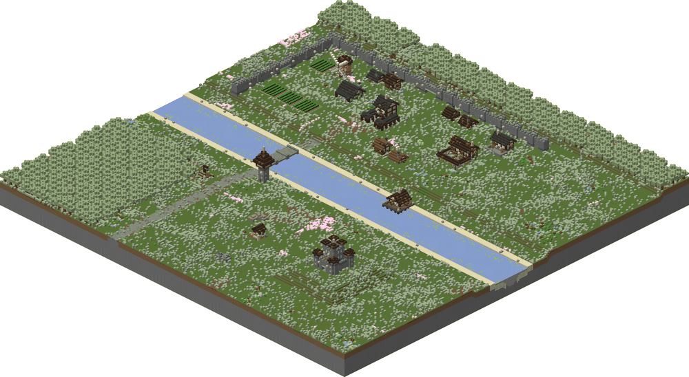
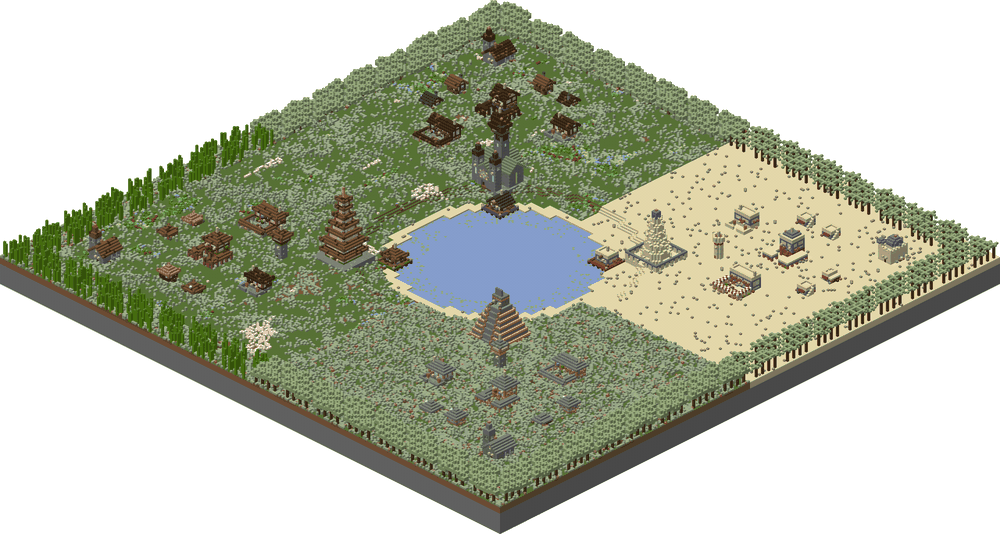
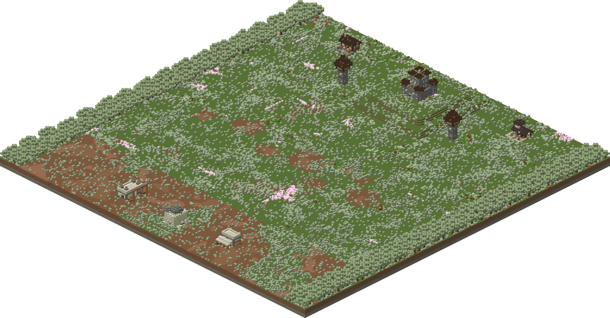
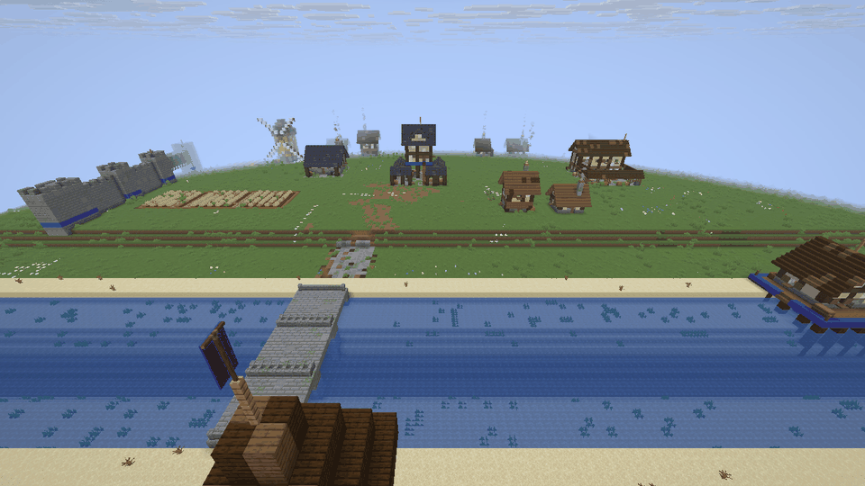
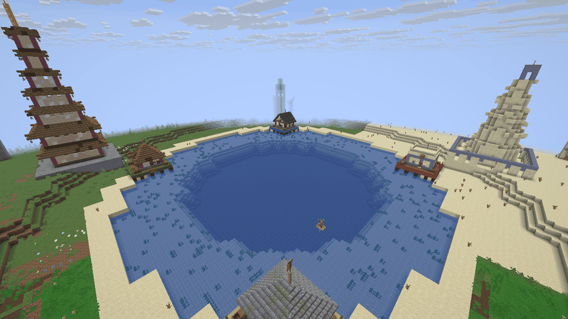
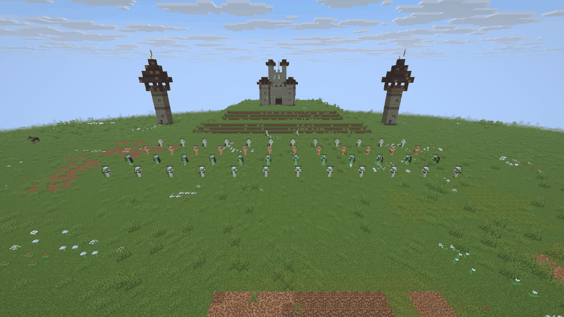

# aoe2mc

Converts an Age of Empires II: Definitive Edition scenario (`.aoe2scenario`) into a Minecraft Java Edition world.

## Gallery

The example maps in `examples/` after the conversion. Click an image for a larger view. Download a converted world,
unzip it and put the folder into the `saves` folder of Minecraft Java.

| River town | Four civilizations | Battle |
|---|---|---|
|  |  |  |
|  |  |  |
| A walled town, a river with a bridge and a dock, a castle on a hill. [Download](https://github.com/Larspolo/aoe2mc/releases/download/worlds/river_town.zip) | Four towns of four architecture sets around a lake, each with its wonder. [Download](https://github.com/Larspolo/aoe2mc/releases/download/worlds/four_civs.zip) | Two armies in formation, siege weapons and a castle. [Download](https://github.com/Larspolo/aoe2mc/releases/download/worlds/battle.zip) |

The top row is a 3D image of the blocks (`tools/render.py`), the bottom row a screenshot of Minecraft (`tools/mc_shot.py`).
The scenario files and how to make them again: `examples/README.md`.

## Files

| File | Description |
|---|---|
| `aoe2mc.py` | The converter (terrain, trees, resources, world writer) |
| `buildings.py` | The building designs (must be in the same folder as `aoe2mc.py`) |
| `units.py` | The unit mapping (must be in the same folder as `aoe2mc.py`) |
| `samples/stress.aoe2scenario` | Test map: units against every side of buildings, trees, mines, cliffs and a mountain, on slopes and on a bridge |
| `samples/unit_gallery.aoe2scenario` | Test map with every unit type |
| `samples/gallery.aoe2scenario` | Test map: every building type, 8 civilizations |
| `samples/test_village.aoe2scenario` | Small test map with terrain, water and a hill |
| `samples/de-64.3.aoe2record` | A recorded AoE2 DE game (1 vs 1, Acropolis), test data for the record reader. License: `samples/de-64.3.aoe2record.LICENSE.txt` |
| `tools/` | Tools for tests and debugging: test scenarios, world reader, 3D render, coverage report, Minecraft data and server check |
| `tests/` | The tests (pytest) |
| `docs/` | Design guide, roadmap, steering, coverage report and other notes |

The repository has no converted worlds. Convert a sample map to get one (see "Use"), or download the converted
worlds: the release `worlds` on the GitHub page of the repository ("Releases") has one zip per map of `examples/` and
`samples/`. Unzip a world into the `saves` folder of Minecraft Java. The workflow `.github/workflows/worlds.yml` makes
the zips: start it in the "Actions" tab, or push a tag `v*` for a release of that tag.

## Install

### Installer (no Python needed)

Download the installer of your system from the
[latest release](https://github.com/Larspolo/aoe2mc/releases/latest). The installers are not signed, so the
system shows a warning the first time. The steps below go past it.

- Windows: start `aoe2mc-<version>-windows-x64-setup.exe`. If Windows SmartScreen shows "Windows protected your PC",
  click "More info", then "Run anyway". The installer needs no admin rights. Start "aoe2mc" from the Start menu.
  The command line is `aoe2mc.exe` in the install folder (default `%LOCALAPPDATA%\Programs\aoe2mc`).
- macOS: open `aoe2mc-<version>-macos-arm64.dmg` (Apple silicon) or `aoe2mc-<version>-macos-x86_64.dmg` (Intel) and
  drag `aoe2mc` into "Applications". The first time, macOS 15 (Sequoia) and later show ""aoe2mc" Not Opened"
  ("Apple could not verify ..."). Do these steps:
  1. Click "Done". Do not click "Move to Bin".
  2. Open "System Settings" → "Privacy & Security". Below "Security", the line ""aoe2mc" was blocked ..." shows
     (for about one hour after the blocked open). Click "Open Anyway" and use Touch ID or your password.
  3. Open the app again and click "Open Anyway".

  On macOS 14 and earlier: right click the app, select "Open", then click "Open" again. The command line is
  `/Applications/aoe2mc.app/Contents/MacOS/aoe2mc`.
- Linux: make the file executable (`chmod +x aoe2mc-<version>-linux-x86_64.AppImage`) and start it: without
  arguments it opens the window, with arguments it is the command line
  (`./aoe2mc-<version>-linux-x86_64.AppImage MyMap.aoe2scenario MyMapWorld`). If it says that FUSE is missing,
  install `libfuse2` or start it with `--appimage-extract-and-run`.

### With Python

Two ways:

- Install the command `aoe2mc`: `pip install .` in the repository folder, or
  `pipx install git+https://github.com/Larspolo/aoe2mc`. This installs the converter and the window, not the game
  program: use the installer of the release, or the repository folder.
- Run the script from the repository folder: `pip install -r requirements.txt`, then use `python aoe2mc.py`.

## Use

    aoe2mc MyMap.aoe2scenario MyMapWorld --preview
    python aoe2mc.py MyMap.aoe2scenario MyMapWorld --preview      (the same, from the repository folder)

A window does the same: start `aoe2mc-gui` (or `python gui.py`), select the scenario or recorded game, set the options
and click "Convert". The world goes into the Minecraft `saves` folder. The window needs Tkinter (on Debian and Ubuntu:
`sudo apt install python3-tk`).

The input can also be a recorded game (`.aoe2record`). The converter then converts its start state: the map, the
start units and the start buildings, like a scenario. All units face the same way (a record has no rotation), and the spawn
is at the town center of player 1. This needs the `mgz` package (in `requirements.txt`):

    aoe2mc samples/de-64.3.aoe2record RecordWorld --preview

With `--at MM:SS` the converter shows the game at that time, as far as the commands in the record show it:

    aoe2mc samples/de-64.3.aoe2record RecordAt10 --at 10:00

The buildings and walls of the build commands until that time stand at their tiles, and the trained units stand at
their building. The record has no positions and no results of the game, so `--at` cannot show: unit moves, dead
units, destroyed or unfinished buildings, cut trees, used mines and farms. A delete command removes only objects of
the start state. A unit from a building that was built later stands at the first building of its player.

Copy the folder `MyMapWorld` into your Minecraft `saves` folder. Open it in Minecraft Java 26.3 or newer. Older games cannot open it.
The world is in creative mode. Outside the map there is only void. The world list shows a small top view of the map
(`icon.png`).
The file `aoe2mc.json` in the world folder lists the map size, the players and each object: AoE2 ID, name, owner,
tile position and rotation, the UUID of the entity (units) and the footprint in blocks (buildings). It also has the
height where a unit stands, for each block column ("ground", "-" for water). A game program can use it.
Buildings make work sounds when you are near them (anvil at the blacksmith, bell at the town center, trade at the
market and more): the world has a small datapack (`datapacks/aoe2mc`) with Minecraft sounds only.

A play test from the start (install, world, join, controls, bug report): `docs/PLAYTEST.md`.

First game: `python3 game/run.py MyMapWorld --play` starts a server on the world. Join it at the address that it prints
and hold the carrot on a stick. Right click a villager of player 1 to select it, then right click a tree: the
villager walks there, chops and carries the wood to the town center. Right click a fruit bush: the villager
forages and carries the food to the town center or a mill, and goes on to the next bush when one is empty.
The sidebar shows the wood and the food. Right click soldiers one after the other to select a group; a second
right click on a selected soldier selects all soldiers of its type near it. A right click with the spyglass "Camera"
(hotbar key 2) puts you on an invisible floor high above the map, where you walk fast (`docs/PLAYTEST.md`).

Live replay of a recorded game: convert the record, then play its commands on a server.

    aoe2mc samples/de-64.3.aoe2record RecordWorld
    python3 game/run.py RecordWorld --replay [--speed 4] [--from 10:00]

`--speed N` plays N times faster than the game, `--from MM:SS` starts at that game time. Join the server at the
address that it prints. The replay shows, at their game time: each building and wall (with the blocks of its
design), chat lines in the player color, age-ups and resigns as a title, and research in the action bar. A trained
unit appears in front of its building. The units of a move order or a right-click order walk to its target at their
AoE2 speed, and a group stops there in a line formation. A villager that an order sends to a tree, a fruit bush
or a mine gathers there at the AoE2 rate: the tree falls and the mine goes when they are empty, and the
villager takes the next one near it. The record has no positions and no results of the game, so the replay cannot
show: fights, dead units, the walks to the drop sites, destroyed buildings or the exact paths of the units. A unit
that has no path stays where it is.

| Option | Default | Description |
|---|---|---|
| `--tile-size` | 4 | Blocks per AoE2 tile, in each direction. 5 or 6 gives more detail. Range 1–16. |
| `--level-height` | 3 | Blocks per AoE2 elevation level. Range 1–16. |
| `--architecture` | from civ | One architecture set for all players |
| `--player-architecture` | – | Architecture set for one player, for example `6=western`. Can be repeated. |
| `--name` | file name | World name in the Minecraft menu |
| `--seed` | 1 | Seed for random details (tree heights, flowers) |
| `--preview` | off | Writes `preview.png` (top view) into the world folder |
| `--mc-version` | 26.3 | Minecraft Java version of the output: only `26.3` |
| `--no-units` | off | Do not convert units |
| `--no-birds` | off | Do not convert birds. Flying birds float 6 blocks above the ground (parrot or bat); peacocks, flamingos, storks and cranes are chickens |
| `--no-barriers` | off | Do not fill building footprints with invisible barrier blocks |
| `--ambience` | basic | `basic`: work sounds at buildings, animal sounds, and particles and sounds by terrain near the player (falling spores in forests, snowflakes, desert dust, frogs, water). `full`: also one biome per terrain group with its own sky, fog and water colors; Minecraft then shows an "Experimental Settings" warning each time the world opens. `off`: a silent world without a datapack |
| `--verbose` | off | Print the time of each phase (read, columns, objects, units, chunks, write) |
| `--scenario N` | all | Campaign: convert only scenario N (1 = the first) |
| `--scenario FILE` | recorded game | The triggers and texts of the scenario FILE of the game (the same map size, #5156). The live replay runs its timer triggers at the times of its clock (#5158) |
| `--orientation C` | `ne` | Minecraft corner (`ne`, `se`, `sw`, `nw`) of the top corner of the AoE2 screen. The map, the building fronts and the units turn with it. |
| `--spawn X,Z` | start view or town center of player 1 | Player spawn in AoE2 tiles. Without it the spawn is the start view of player 1, else the front of its first town center, else the map center. |
| `--garrison {inside,outside,skip}` | `inside` | Garrisoned units: a ship carries its units in stacks of up to 4 on each boat seat. `inside` puts each other unit inside its building. It does not move, it cannot die and its name does not show. `outside` puts each unit next to the building or unit that holds it. `skip` does not convert them. |
| `--border {diorama,island,natural,table,wall,none}` | `diorama` | Edge outside the map. `diorama`: the map stands on a plinth of stone bricks. `island`: the map floats on a cone of rock and earth. `natural`: the ground slopes down into a ring of sea. `table`: the map lies on a dark oak table with legs, lanterns and a banner in a player color on each corner. `wall`: a low wall with a tower in a player color at each corner. `none`: no blocks. All keep the vanilla world border at the map edge. Images: `docs/images/border-*.png`. |
| `--mood {on,off}` | `on` | The map color mood of a DE scenario. `on`: the time of day (Night and Darkness at midnight, Evening and Twilight at sunset, all others at noon) and rain in the wet moods (Murky, Rainforest, Swamp; snow in the cold biomes). `off`: noon for all maps, no rain and no fog. |
| `--fog` | off | Fog in the fog moods (Brumous, Misty, Murky): the fog starts 4 blocks away and ends 48 blocks away. `--ambience full` turns it on too. Minecraft then shows an "Experimental Settings" warning when the world opens. `--mood off` turns it off. |
| `--resource-pack` | off | A resource pack in the world (`resourcepacks/resources.zip`): single player loads it with the world, the zombie units get a human face, and the units hold AoE2 weapons (halberd, spear, long bow ...). |

## Campaigns

A campaign file gives one world for each scenario, in the output folder: `<number> <scenario name>/`.

    aoe2mc MyCampaign.aoe2campaign CampaignWorlds                  (AoE2 DE: one world per scenario)
    aoe2mc MyCampaign.aoe2campaign CampaignWorlds --scenario 2     (only the second scenario)

An old campaign (`.cpx` from The Conquerors or AoE2 HD, `.cpn`) holds scenarios in the old format (`.scx`, `.scn`).
The converter converts its `.scx` scenarios of format `1.21` directly: one world per scenario, as above.

    aoe2mc OldCampaign.cpx OldWorlds

It cannot read the other scenarios (other format versions, `.scn`). It writes them to the output folder
(`<number> <file name>`) and stops with these steps:

1. Copy the files to the scenario folder of AoE2 DE
   (`<Steam user folder>/Games/Age of Empires 2 DE/<number>/resources/_common/scenario`).
2. In the DE scenario editor, open each scenario and save it as `.aoe2scenario`.
3. Convert each `.aoe2scenario` file, or make a campaign of them in the DE campaign editor and convert it.

An old scenario of The Conquerors (`.scx`, format `1.21`) converts directly, without the DE editor:

    aoe2mc OldScenario.scx OldWorld

The converter reads the map, the players and the objects. It gives no book with the scenario texts. Other `.scx`
format versions and `.scn` files give an error with the version: use the DE editor steps above for them.

The file layouts are in [`docs/campaign-formats.md`](docs/campaign-formats.md).

## Maps in JSON

A map description in JSON converts without an AoE2 file. Use it for generated maps and tests:

    aoe2mc Map.json MapWorld --preview

    {"size": 16,
     "terrain": [[0, 0, ...], ...],
     "elevation": [[0, 0, ...], ...],
     "objects": [{"name": "TOWN_CENTER", "player": 1, "x": 6.0, "y": 6.0, "rotation": 0}],
     "players": {"1": {"civ": "BRITONS", "color": 0}}}

- `terrain`: `size` lists of `size` terrain IDs, indexed `[x][y]` (AoE2ScenarioParser `TerrainId`, for example 0 is
  grass and 22 is deep water).
- `elevation`: the elevation levels, in the same layout. It is optional (default 0).
- `objects`: the AoE2 object names (`aoe2mc.object_kinds()`, for example `TREE_OAK`, `GOLD_MINE`, `VILLAGER_MALE`),
  with the tile position. Player 0 is GAIA. `rotation` is optional.
- `players`: the civilization and the color index (0 blue to 7 orange, default: the player number - 1).

An unknown terrain ID or object name gives an error.

## Random map scripts

A random map script (`.rms`) of your own AoE2 install gives the land of one random map. The seed selects the map:
the same seed gives the same map. A `ZR@NAME.rms` archive (a zip of the script and its files) works in the same way.

    aoe2mc Arabia.rms ArabiaWorld --seed 7 --preview

The converter reads the land part of the script: the player lands on a circle, the other lands, and the terrains of
`<TERRAIN_GENERATION>` (forests get their trees). It makes a map for 2 players, with elevation 0 and no other
objects yet. It prints a warning for each section and attribute that it does not read yet. The repository has no
script of the game.

Without AoE2, use an own generator of the program. It needs no game file:

    aoe2mc --random-map arabia ArabiaWorld --seed 7 --preview

Arabia gives open grass and dirt land, small forests and ponds, and 2 players on a circle. Each player gets a town
center, 3 villagers, a scout, sheep, berry bushes, gold and stone mines, boars and deer.
`--random-map arena` closes each player in a circle of stone walls with a forest inside it, and has open land
between the circles. `--random-map black_forest` covers most of the map with forest, with open player lands, an open
middle and open paths between them. `--random-map nomad` has a sea in the middle and no town center: the 3 villagers
of each player stand apart, and the player builds the town center. `--random-map islands` gives each player an own
island with a beach, and water between the islands. `--random-map gold_rush` puts many gold mines in the middle of
the map, in a ring of forest with gaps. `--random-map highland` puts a river with shallow fords between the players:
units walk across only at the fords. `--random-map mediterranean` has a sea with a beach in the middle of the map, and
the player lands around it.

## Buildings

Each building fills its AoE2 footprint. The front (main door) is on the south side, as in the AoE2 camera view.
The program reads the player color and civilization from the scenario. Each civilization uses one of 9 architecture sets:

| Set | Civilizations | Wonder |
|---|---|---|
| western | Britons, Franks, Celts, Burgundians, Sicilians, Saxons | Gothic cathedral |
| central | Goths, Teutons, Vikings, Huns, Slavs, Magyars, Bulgarians, Lithuanians, Poles, Bohemians, Varangians, Danes | Gothic cathedral |
| mediterranean | Byzantines, Spanish, Italians, Portuguese, Romans, Armenians, Georgians, Greek civs | Gothic cathedral |
| middle_eastern | Persians, Saracens, Turks, Berbers, Achaemenids, Tatars, Cumans | Mosque |
| south_asian | Hindustanis, Dravidians, Bengalis, Gurjaras, Puru | Mosque |
| african | Ethiopians, Malians | Mosque |
| east_asian | Japanese, Chinese, Koreans, Mongols, Shu, Wu, Wei, Jurchens, Khitans | Pagoda |
| southeast_asian | Khmer, Malay, Burmese, Vietnamese | Angkor temple |
| mesoamerican | Aztecs, Mayans, Incas, Muisca, Mapuche, Tupi | Stepped pyramid |

Other supported objects: bridges, aqueducts, army tents, pavilions, yurts, huts, the amphitheatre, monuments,
landmark cathedrals, mountains, quarries, graves, ruins and shipwrecks.

The scenario texts (instructions, hints, victory, loss, history, scouts) are in a written book on a lectern
near the spawn. Each text is a chapter. There is no lectern when all texts are empty.

## Units

All units stand still (no AI), do not despawn and are silent. Passive animals (sheep, cows, pigs and others) make their normal sounds. Each unit has a name tag with its AoE2 name in the player color.
The world difficulty is Easy: on Peaceful, Minecraft removes the hostile mobs (the soldiers).

| AoE2 | Minecraft |
|---|---|
| Villagers | Villager with a matching profession |
| Monks, missionaries, priests | Evoker |
| Infantry | Zombie with sword or axe; spear units with trident |
| Archers / crossbow units | Skeleton with bow / crossbow |
| Skirmishers and other throwers | Drowned with trident |
| Gunpowder infantry | Pillager |
| Cavalry | Zombie on a horse with horse armor |
| Mounted archers | Skeleton on a skeleton horse |
| Camel units / elephants | Camel / ravager with a rider |
| Siege weapons | Minecart with a crew (zombie for rams, vindicator for mangonels and trebuchets, skeleton for scorpions, pillager for gunpowder) |
| Ships | Boat; crew and wood show the type (villager = fishing, blaze = fire ship, creeper = demolition ship, pillager = cannon ship, skeletons = warships) |
| King, queen | Zombie with a gold helmet |
| Trade carts | Donkey with a chest |
| Animals | Sheep, cow, pig, wolf, horse, llama, goat, chicken, fox, camel; boars, rhinos, crocodiles and bears are hoglins; small exotic animals are sheep |
| Fish (resources) | Cod, salmon, tropical fish |
| Relics | Decorated pot |

Armor shows the upgrade step: leather helmet, chainmail, iron, diamond. Unique units have gold armor, elite unique units netherite.
Helmets are unbreakable, so zombies and skeletons do not burn in the sun.

## Details and variation

Each building gets a random seed from its position, so a map always converts the same way, but no two buildings are the same:
- Houses have four designs: cottage, front gable, two floors with an overhanging upper floor, and cottage with a woodshed.
  The chimney position changes.
- Plaster, roof material and timber change a little (for example white or ochre plaster, wood or slate roofs).
- Glass windows can get open shutters, a sill and flower pots.
- Free ground next to the walls gets barrels, hay, firewood, lanterns, beehives and other things.
- Walls are not made of one block: similar blocks are mixed in (for example cracked and mossy stone bricks,
  calcite in white plaster, other tiles in a roof). The main block stays the large majority, so each building
  stays recognizable. Stone buildings have corner stones, half-timbered buildings a stone base row.
- Every 4th wall tile has a banner in the player color.

## Architecture sets without timber framing

Middle Eastern, South Asian and African buildings have plaster walls with stone bands instead of half-timbering:
a base row, a cornice and pilasters in an accent color, a parapet of wall blocks on the flat roof, and
(depending on the set) a sloped overhang under the roof (South Asian chhajja), small domed kiosks on large roofs
(chhatri), and wooden beams that stick out of the walls (African mud architecture).

| Set | Walls | Accent | Domes |
|---|---|---|---|
| South Asian | beige sandstone | red sandstone | white quartz |
| Middle Eastern | beige sandstone | light blue tiles | light blue |
| African | terracotta (mud) | brown terracotta | terracotta |

## Ground

Grass, forest, dirt and sand get patches and plants that are only decoration: worn and mossy patches,
short and tall grass, flower fields (one kind of flower per field), pink petals, ferns, mushrooms, moss carpet
and dead bushes.
Dirt is steppe: coarse dirt with patches of dry grass. Cliffs join into continuous rock ridges (snow on top in snow areas).
Fences are low wooden fences that connect to each other.
Roads are a mix of cobblestone, andesite, stone, gravel, tuff and cracked stone, with worn patches in the middle,
rough edges and worn verges of dirt path beside the road.

## Barriers

Like in AoE2, units cannot walk into, through or over buildings: the free space of each footprint is filled with
invisible barrier blocks up to 1 block above the building. Gates and bridges stay open, and farms are not filled.
Trees, gold and stone mines, berry bushes, rocks, cliffs and mountains also block their tile (3 blocks high),
so you cannot walk through a forest.
Use `--no-barriers` to walk into the buildings.

## Footprints

Every building and object (tree, mine, cliff, rock, mountain) keeps its blocks inside its AoE2 footprint up to head height
(3 blocks above the ground of each column). Only roof edges, tower tops, sails and tree crowns above that may stick out.
Thus a unit can always stand directly next to an object. Units over water stand on a bridge or dock deck if there is one.
The converter reports "units in a block"; this number must be 0.

## Decorations

Statues, column statues, shrines, market stalls, wells, hay stacks, lumber and siege props, barrels, weapon racks,
targets, rugs, vases, flower beds, fern patches, hedges, grapevines, broken carts, bonfires, signs, gallows and
oysters have small designs. Roads mix several stones and get worn edges.
If a scenario puts a unit on a building or an obstacle (possible in the AoE2 editor), the unit moves to the nearest free place.

## Overlapping objects

Eye-candy scenarios often place buildings on top of each other. A building that lies for more than 80% under one
larger building is skipped (for example a wonder that is hidden under the Great Pyramid). Natural objects
(trees, rocks, cliffs, mountains, mines) place no blocks inside building footprints.

## Development

    python3 -m pip install -r requirements-dev.txt
    ruff check .
    python3 -m pytest              # fast tests
    python3 -m pytest -m slow      # slow tests

Read these files first:
- [`CLAUDE.md`](CLAUDE.md): commands, code map and the rules of the domain.
- [`framework/docs/STEERING.md`](framework/docs/STEERING.md): how the owner steers the work with GitHub issues.
- [`steering/project/ROADMAP.md`](steering/project/ROADMAP.md): the plan.
- [`docs/DESIGN.md`](docs/DESIGN.md): the rules for building, object and unit designs.
- [`framework/docs/SYSTEM.md`](framework/docs/SYSTEM.md): the agent system that does the work, and the setup steps of the owner
  ("Setup steps of the owner"; a move to another Claude account: `framework/docs/OPERATOR.md`, section 4).

## Known limits

- Object types that the parser does not know (new IDs) are skipped.
- Garrisoned units stand next to their holder. A ship stacks them on its boat seats: each unit rides the unit below it,
  up to 4 units on a seat. The name tag of a full ship shows the rest, for example "Transport Ship (+6)".
- The direction that units face is not checked in the game yet. See [`docs/facing.md`](docs/facing.md) for the check.
- In scenarios older than version 1.56 the architecture set field can be wrong, so the program uses the civilization.
- Unique buildings use the design of a similar building (for example krepost → small castle).
- Map tile (x, y) becomes block (x × tile-size, z = y × tile-size). AoE2 shows the map as a diamond with the top corner
  at the top of the screen. In Minecraft this corner is in the north-east: the map is the in-game view turned 45°
  clockwise, not mirrored. A turn of 45° is not possible on a block grid. At the spawn the player looks north-east,
  as the AoE2 camera does. Use `--orientation` to put the top corner in another corner (the spawn view turns too).

## License

aoe2mc is free software under the GNU General Public License version 3 (GPL-3.0): see [`LICENSE`](LICENSE).
The licenses of the third-party files and packages are in [`docs/THIRD_PARTY.md`](docs/THIRD_PARTY.md).
